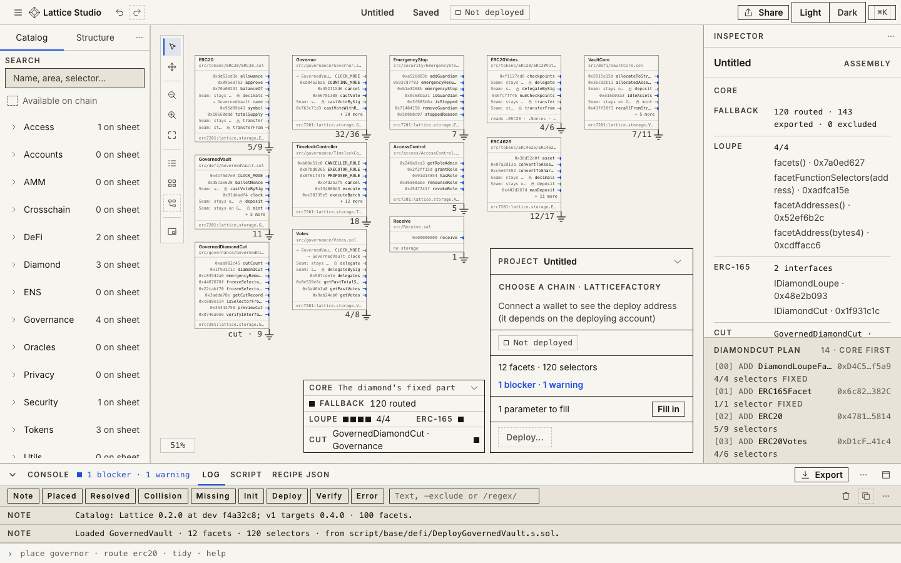

# Lattice Studio

Build an EIP-2535 diamond in your browser. A diamond offers one contract address and routes function calls to contracts called *facets*. A Studio recipe records which facets to use and how to initialize them.

[**Open Lattice Studio**](https://lattice-studio-topaz.vercel.app) · [Watch the demo](https://youtu.be/Twkk9R-VbK0)

## Features

- **Compose a diamond.** Start with a recipe or drag facets from the Lattice catalog onto the sheet. Inspect a facet to see which functions it contributes.
- **Check every edit.** Studio flags conflicting function selectors, overlapping storage, missing dependencies, and problems with initialization or upgrade permissions.
- **Save and share.** Studio saves your project in your browser. Share a recipe by link, download its JSON, or export an agent brief for review.
- **Export or deploy.** Generate a Foundry script or a Safe Transaction Builder batch. To deploy from Studio, review the predicted address and simulation before signing on a supported testnet.

<picture>
  <source media="(prefers-color-scheme: dark)" srcset="apps/studio/public/pitch/sheet-dark.png" />
  
</picture>

## Build your first diamond

1. Under **Start a diamond**, choose **ERC20**. The recipe adds the facet that handles token functions such as `balanceOf(address)`. This starter has zero supply and exposes no minting or upgrade functions.
2. Choose **Edit setup** (on a phone, open **Inspector** first). Set **Name** to `Library Credits` and **Symbol** to `LIB`, then choose **Back to composition**.
3. Choose **Next problem** to review the remaining warning. It tells you that sending ETH directly to the token address will revert. You can export or deploy with this warning.

### Export or deploy

- **Export a file.** Open **Export**, choose **Recipe JSON**, then **Download** to save `recipe.json`. You can save a work in progress. Once you resolve any blockers, you can also choose **Foundry script** or **Safe batch…**.
- **Deploy to a testnet.** Choose a testnet, connect a wallet funded with its test tokens, and open **Deploy…**. If the network is missing facets or other shared contracts, Studio offers **Deploy missing contracts…**. Review the predicted address, simulation, and gas estimate, then choose **Sign & deploy**. After confirmation, Studio compares the on-chain function routing with your recipe.

## Run locally

Install [Bun](https://bun.sh), then run these commands from your terminal.

```sh
git clone https://github.com/dadadave80/lattice-studio.git
cd lattice-studio
bun install --frozen-lockfile
bun dev
```

Open the URL printed by the dev server (default `http://localhost:5173`). The checkout includes the facet catalog.

## Verified deployment

**First Lattice Token (FLT)** was deployed from Studio to Sepolia in one transaction. Sourcify records an exact match for the diamond’s creation and runtime bytecode. [Deployment transaction](https://sepolia.etherscan.io/tx/0xc3464766712590e02e70444a0835c46dfd8db1c02cabbbd94aea440dddade969) · [Verified source on Sourcify](https://repo.sourcify.dev/11155111/0xF70f3E9D2183B4e829DB615E08551bafcE6C9755)
